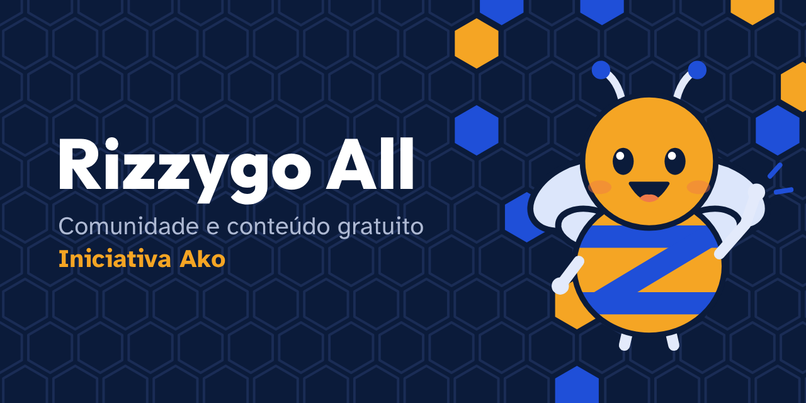

# Rizzygo

Tecnologia para pessoas. A Rizzygo ajuda pessoas a entrar e crescer em tecnologia, começando por uma comunidade aberta e gratuita.

## Por onde começar

| Repositório | O que é | Onde usar |
| --- | --- | --- |
| [ako](https://github.com/rizzygo/ako) | Trilhas de estudo em português, mapas das áreas da TI, guias e lições, abertos e gratuitos | [ako.rizzygo.com.br](https://ako.rizzygo.com.br) |
| [favos](https://github.com/rizzygo/favos) | Plugins e skills abertos para IA de código, em português: estudo, trilhas do Ako e carreira | `claude plugin marketplace add rizzygo/favos` |

O site da Rizzygo fica em [rizzygo.com.br](https://rizzygo.com.br).

## All, Mentoria e Empresas

- **Rizzygo All: (Ako)** conteúdo aberto e gratuito, de todos para todos. O Ako e os Favos estão no ar, e o Rumo e o Papo de Colmeia estão em construção. É a casa da Zumi, a abelha da Rizzygo All: onde ela aparece, é gratuito.
- **Rizzygo Mentoria:** o Zygo Way, mentoria individual com o fundador, como investimento particular, em dois programas: Cloud, DevOps, SRE e Platform Engineering; e De Júnior a Especialista ou Tech Lead.
- **Rizzygo Empresas:** Kumo, Métis e Tékne, para times que querem ganhar maturidade em tecnologia.

Achou um erro ou tem uma ideia? Abra uma issue no repositório do assunto. Para conversar, fale com o fundador, Danilo Rizzo, no [LinkedIn](https://www.linkedin.com/in/danilo-rizzo-20bb6982).

*Sou Zy: domino o ofício, questiono o jeito, caminho junto, compartilho o que sei e lidero servindo.*
